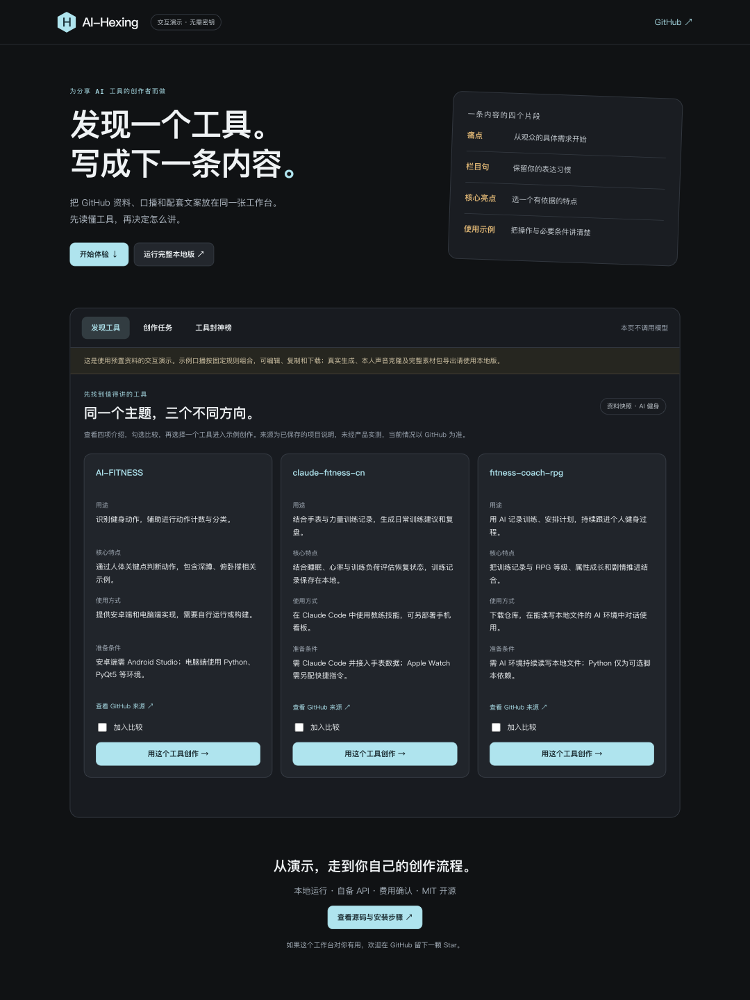
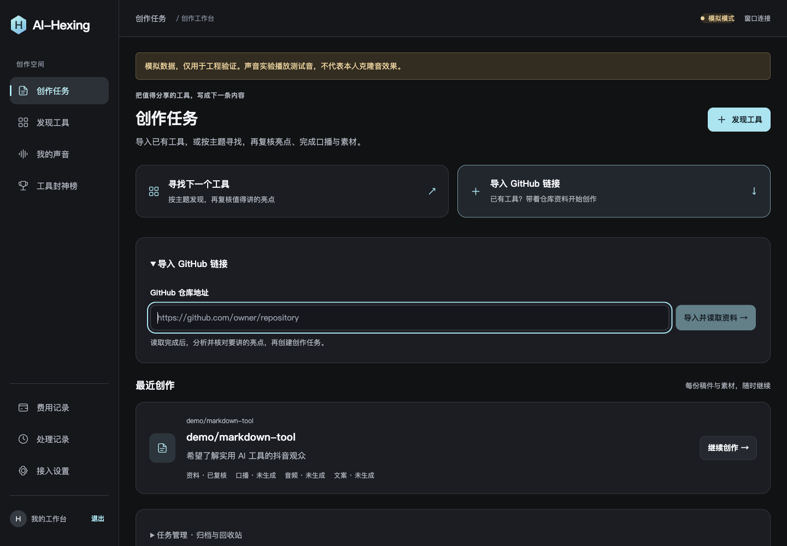
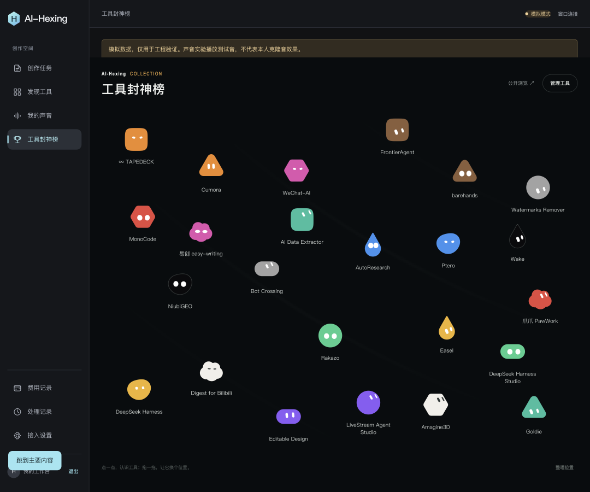

# AI-Hexing

**把 GitHub 工具，变成一条能录、能讲、能发布的短视频创作素材。**

[在线体验](https://hexing-ai.github.io/AI-Hexing/) · [快速运行](#快速运行) · [使用说明](docs/public/USAGE.md) · [架构](docs/public/DEVELOPMENT.md)

发现工具 → 核对亮点 → 四段口播 → 本人声音配音 → 素材包导出。减少在仓库资料、文稿和音频工具之间来回整理的工作。

AI-Hexing 是面向 AI 工具内容创作者的本地工作台：从寻找工具、核对资料，到编写口播、使用本人克隆音配音和导出素材，在同一套流程中完成。内容生成后由创作者审阅、采用和确认。

**当前版本：0.1.0 · 本地 MVP · MIT**

默认使用模拟服务，可以不配置模型密钥体验流程。真实 GitHub、Qwen 与 CosyVoice 已接入，并完成过一份真实配音及完整素材包验收。当前版本以单创作者、本机运行为范围。

## 30 秒体验

[打开交互 Demo →](https://hexing-ai.github.io/AI-Hexing/)

无需注册或密钥：比较 3 个健身工具，选择一个进入四段示例口播，编辑后下载文本；也可以查看 24 个工具 Bot。Demo 使用公开资料快照和规则组合示例，不调用真实模型、不收集录音、不连接你的本地工作台。

[](https://hexing-ai.github.io/AI-Hexing/)

## 完整工作台

以下为独立模拟环境的工作台预览，不包含正式账号、录音或模型凭证；模拟音频只是测试音。在线 Demo 与榜单预览通过 ego lite 页面打印渲染生成，创作任务图为既有隔离验收截图。





## 能做什么

| 页面 | 用法 |
| --- | --- |
| 发现工具 | 按主题找候选，查看用途、核心特点、使用方式和准备条件，最多比较 3 个工具，选定后导入复核 |
| 创作任务 | 导入已有 GitHub 链接，或继续已有稿件；生成、编辑、采用及确认四段口播与配套文案 |
| 我的声音 | 上传本人录音，创建并试听音色；复用、重命名、设置默认声音和批量移除列表记录 |
| 工具封神榜 | 查看内置 24 个精选工具的 Bot、介绍与 GitHub 链接；管理自己的榜单草稿、发布和下架 |
| 费用与处理记录 | 调用前确认费用，查看预算、生成结果、失败原因和待核对事项 |

已确认的口播可生成完整配音。音频满足 30–35 秒且经试听采用、同稿文案确认后，可导出包含口播 TXT、文案 TXT、WAV 和版本说明 JSON 的 ZIP。视频录屏、剪辑和上传由创作者在外部工具完成。

`/ranking` 的内置精选工具用于工作台展示；匿名 `/display` 只读取明确发布的榜单副本。安装仓库不会自动将你的草稿、私有素材或全部内置工具发布到匿名页。

## 快速运行

需要 **Python 3.11、Node.js 22（含 npm）、Git**，支持 macOS / Linux。Windows 建议在 WSL2 内尝试，尚未独立验收。

```bash
git clone https://github.com/hexing-ai/AI-Hexing.git
cd AI-Hexing
python3.11 scripts/setup.py
.venv/bin/python -m backend.app.cli create-owner
python3.11 scripts/start.py
```

安装脚本下载锁定依赖、创建默认 mock 配置并迁移数据库；已有 `.env` 会保留，已有数据库请先备份。创建账户时输入自己的账号和至少 12 位密码，没有默认密码，已有账户跳过该步骤。

Web 显示 `Ready` 后打开 **http://127.0.0.1:3060/discover**。`Ctrl+C` 同时停止本次启动的 API、worker 和 Web。端口 3060 / 8010 被占用时，脚本会提示退出，不结束其他进程。首次安装耗时取决于网络；不承诺冷启动三分钟完成。

**第一次体验：** 登录 → 创作任务 → 导入 `https://github.com/ollama/ollama` → 分析并复核资料 → 创建任务 → 生成并编辑口播。默认 mock 只演示流程，既不搜索真实工具，也不产生真实克隆音。

- [逐步操作与手动启动](docs/public/USAGE.md)
- [接入真实 GitHub、Qwen、CosyVoice 与费用控制](docs/public/CONFIGURATION.md)
- [架构、目录与开发检查](docs/public/DEVELOPMENT.md)
- [当前限制与后续计划](docs/public/STATUS.md)
- [发布验证记录](docs/public/RELEASE.md)

## 技术方案

- 前端：Next.js 16、React 19、TypeScript。
- 后端：FastAPI、SQLAlchemy、SQLite、Alembic。
- 后台：持久化作业、输入幂等、结果检查点、失败与用量留存。
- 模型：阿里云百炼 Qwen 文本生成、北京地域 CosyVoice 音色创建与合成。
- 展示：基于 [bloub](https://github.com/jeremy-prt/bloub) 的 Bot 引擎，结合 React 渲染与 Matter.js 交互。

SQLite 文件、录音、生成音频和密钥保存在本机。真实模式会按具体操作将相关资料交给 GitHub、百炼或配置的 OSS；本地运行并不表示模型在本地推理。

## 验证范围

已完成真实“资料复核 → 口播与文案确认 → 33.94 秒克隆配音 → 完整素材包”案例。更多工具的质量抽检、最新整批摘要的真实质量与延迟、手机真机性能以及生产部署恢复仍需继续验证。通过模拟测试不等于真实模型效果达标。

项目不自动运行下载的 GitHub 源码，不自动剪辑或发布视频，也不提供多用户 SaaS 和付费会员体系。完整限制见 [版本状态](docs/public/STATUS.md)。

## 参与项目

欢迎通过 [Issues](https://github.com/hexing-ai/AI-Hexing/issues) 提交复现步骤或改进建议。请使用示例资料，勿附上 `.env`、API Key、个人录音、签名 URL 或本地数据库。提交前的检查见 [开发文档](docs/public/DEVELOPMENT.md)。

如果它帮你缩短了从发现工具到写出内容的过程，欢迎 Star；实际使用反馈比功能愿望清单更能帮助改进。

## 许可证

AI-Hexing 以 [MIT License](LICENSE) 发布。第三方组件保留各自许可证与版权信息，详见 [THIRD_PARTY_NOTICES.md](THIRD_PARTY_NOTICES.md)。精选工具条目仅提供简要介绍和来源链接，不改变对应项目的许可或商标权利。
