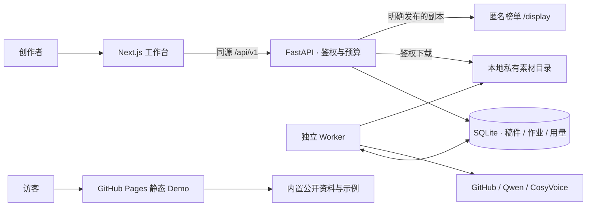

# 架构与开发

## 目录

```text
backend/
  app/api/          业务接口
  app/core/         配置、鉴权、数据库
  app/services/     搜索、生成、配音、导出与预算
  app/services/prompts/ 版本化 Prompt
  alembic/versions/ 数据库迁移
  tests/            隔离测试与模拟浏览器环境
frontend/
  app/              页面路由
  components/       工作台与 Bot 界面
  lib/              API、数据整理和第三方 Bot 引擎
  public/           静态资源与第三方许可证
demo/               无账号、无 API 的静态交互 Demo
scripts/            安装、服务启动与 Git 发布文件检查
docs/public/        对外使用与开发文档
```

Web 在同源 `/api/v1` 代理到本地 FastAPI。SQLite 持久化账户、资料、任务、版本与作业；独立 worker 执行后台工作。私有文件经鉴权接口访问，不放入前端静态目录。最新迁移为 `0010`。

生成结果不会直接覆盖已采用稿件。外部发送边界、幂等记录和结果检查点用于减少重复调用；结果未知的作业需要核对。公开榜单读取明确发布的字段副本，不直接返回私有任务对象。

## 数据如何流动



Demo 与完整工作台是两个独立入口。Pages 只托管 `demo/`，没有后端、登录、API 代理和真实合成；编辑内容只存在当前页面，刷新后重置。它不接触本地数据库或录音。完整工作台的付费操作由服务端预算检查、显式确认和 worker 执行。

## 自动检查

在根目录安装依赖后运行：

```bash
.venv/bin/python -m pytest backend/tests -m "not live"
.venv/bin/ruff check backend
npm --prefix frontend run lint
npm --prefix frontend run build
npm --prefix frontend run typecheck
python3 scripts/check_release.py --worktree
```

后端测试使用临时数据库和模拟供应商；`backend/tests/live/github_smoke.py` 是单独的真实 GitHub 脚本，不在上述 pytest 命令中调用。CI 不配置供应商密钥，不调用真实模型，不执行旧 Playwright 浏览器套件。

GitHub Actions 在 push / pull request 时检查后端回归、Ruff、前端 ESLint、构建与类型，并核查提交文件范围。新克隆目录可使用 `python3 scripts/check_release.py` 检查 Git 索引；`--worktree` 另外检查未跟踪且未被忽略的文件。脚本仅报告文件位置，不回显疑似密钥；启发式扫描不能代替人工检查截图与内容。

## 浏览器验收

当前维护流程使用 ego lite 的独立 Agent Space。仓库中的 Playwright 用例属于历史测试参考，部分路径已随页面迭代变化，不作为当前版本全部通过的证明。

```bash
HEXING_QA=1 npm --prefix frontend run build
.venv/bin/python -m backend.tests.browser_server
```

使用独立测试数据库 `data/browser-qa/qa.sqlite`、API 18060 和 Web 13060。打开 `http://127.0.0.1:13060/tasks`，测试账户凭据临时写在 `data/browser-qa/credentials.json`，仅用于本机隔离环境。结束时在服务终端 Ctrl+C，服务会删除临时凭据。不要公开或提交 `data/`。

正式服务使用 3060 / 8010；QA 构建写入 `.next-qa`，避免覆盖正式 `.next`。正式服务运行时，不要用普通 build 覆盖其构建目录。

## 提交边界

根目录 PRD、通用技术手册、旧设计参考、内部验收记录及录音等均保留本地并被 Git 忽略。公开测试使用 `backend/tests/fixtures/` 下可分发的独立数据，不依赖内部验收目录。

修改 Next.js 代码前，按 `frontend/AGENTS.md` 阅读当前安装版本的对应文档。第三方 bloub 引擎的来源版本和声明见 `frontend/lib/bloub/NOTICE.md`。
